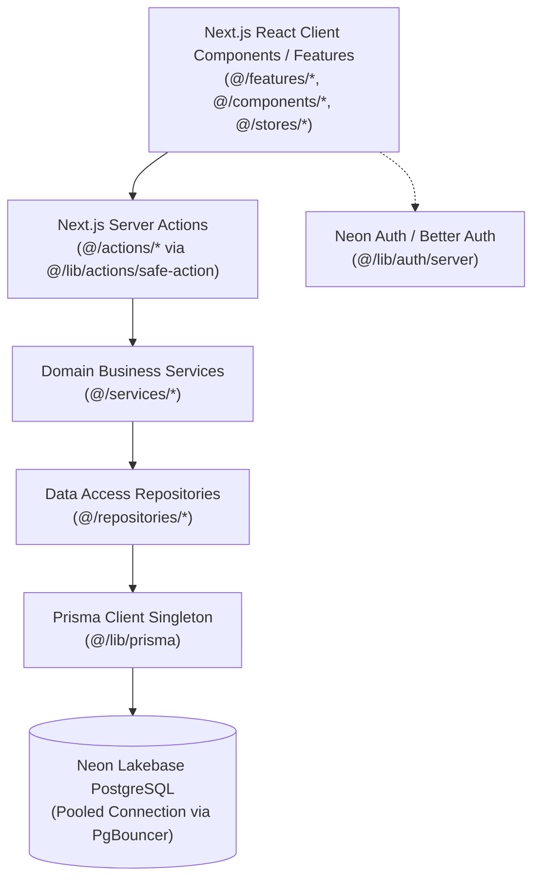

# Anchor Fashion - Developer Architecture & Best Practices Guide

Welcome to the **Anchor Fashion** codebase! This guide serves as the canonical handbook for human software engineers contributing to the repository. It outlines our architectural layers, database patterns, authentication mechanisms, and code quality standards.

---

## 🏗️ 1. High-Level Architecture Overview

Anchor Fashion is built with a clean, domain-driven multi-tier architecture using **Next.js 16 (App Router)**, **Neon Lakebase Postgres**, **Prisma ORM**, and **Neon Auth (Better Auth)**:



---

## 🗄️ 2. Database & Persistence Best Practices

### Connection Strings
- **`DATABASE_URL`**: Used by the live application at runtime. Always points to the **Neon connection pooler** (`*-pooler.neon.tech`) with `?sslmode=require&pgbouncer=true`.
- **`DIRECT_URL`**: Used exclusively for migrations and schema introspection (`prisma db push`, `prisma migrate`) via the unpooled direct endpoint.

### Prisma Client Singleton
Always import the singleton Prisma instance from `@/lib/prisma`:
```typescript
import { prisma } from "@/lib/prisma";
```
*Never* instantiate `new PrismaClient()` inside components, route handlers, or action files, as this exhausts connection pools in serverless environments.

### Query Egress & Performance
- Avoid unbounded `prisma.model.findMany()` queries. Always supply pagination (`take` and `skip`).
- Use `select` or explicit `include` only for fields needed by the view to prevent egress spikes over the wire.
- Never write raw SQL string interpolations (`$queryRawUnsafe`). Always use Prisma's parameterized queries to eliminate SQL injection vulnerabilities.

---

## 🔐 3. Authentication & RBAC Authorization

### Role-Based Access Control (RBAC)
User roles are stored authoritatively in the database (`roles` and `profiles` tables). Neon Auth provides session management.

### Authoritative Role Resolution
When validating user roles, always use `resolveUserRole(user)` from `@/lib/auth/server`:
```typescript
import { getServerSession, resolveUserRole } from "@/lib/auth/server";
import { ADMIN_ROLES, STAFF_ROLES } from "@/lib/constants/auth";

export async function ExampleServerAction() {
  const { user } = await getServerSession();
  if (!user) throw new Error("Unauthorized");

  const role = await resolveUserRole(user);
  if (!STAFF_ROLES.includes(role)) {
    throw new Error("Forbidden");
  }
}
```

### Centralized Role Constants (`@/lib/constants/auth`)
Use centralized constants rather than hardcoded strings:
- **`ADMIN_ROLES`**: `["SUPERADMIN", "SUPER_ADMIN", "ADMIN"]`
- **`MANAGER_ROLES`**: Operational leadership roles.
- **`STAFF_ROLES`**: All internal management, warehouse, finance, marketing, and support roles.

---

## 🛡️ 4. Server Actions & Safe Action Wrapper

All server actions must be validated through our safe action factory in `@/lib/actions/safe-action`:

### Types of Actions:
1. **Public Action** (`createSafeAction`): Validates input schema via Zod for public endpoints.
2. **Authenticated Action** (`createProtectedAction`): Ensures a valid authenticated user session exists.
3. **Admin Action** (`createAdminAction`): Ensures the user possesses an administrative or operational staff role.

### Example Server Action Implementation:
```typescript
import { z } from "zod";
import { createAdminAction } from "@/lib/actions/safe-action";
import { inventoryService } from "@/services/inventory.service";

const UpdateStockSchema = z.object({
  sku: z.string().min(1),
  quantity: z.number().int().min(0),
});

export const updateStockAction = createAdminAction(
  UpdateStockSchema,
  async (input, { user }) => {
    return await inventoryService.updateInventoryLevel(input.sku, input.quantity, user.id);
  }
);
```

---

## 📦 5. Repository & Service Pattern

1. **`repositories/`**: Handles pure database interactions (Prisma queries, data projections, filtering).
2. **`services/`**: Implements domain business rules, cross-repository orchestrations, email notifications, payment workflows, and financial calculations.
3. **`actions/`**: Thin wrapper exposing services to React components, performing Zod validation and session authentication.

---

## 🏪 6. State Management (Zustand)

Global client-side states reside in `@/stores`:
- Store filenames are kebab-cased: `use-cart-store.ts`, `use-checkout-store.ts`, `use-wishlist-store.ts`.
- Prefer database-backed synchronization with server actions where persistence matters (e.g. cart items synced with customer profile).

---

## 🧪 7. Running Tests & Database Scripts

Check [`scripts/README.md`](file:///c:/Users/BIJOY%20PARTHO/Desktop/anchorfashion/ancorfasion/scripts/README.md) for full script documentation.

- **Run Full Automated QA Suite (54 Tests)**:
  ```bash
  npx tsx scripts/qa_full_suite.ts
  ```
- **Seed All 10 QA Accounts**:
  ```bash
  npx tsx scripts/seed_all_qa_roles.ts
  ```
- **Sync Product Categories**:
  ```bash
  npx tsx scripts/sync_categories.ts
  ```
- **Check TypeScript Types**:
  ```bash
  npx tsc --noEmit
  ```
